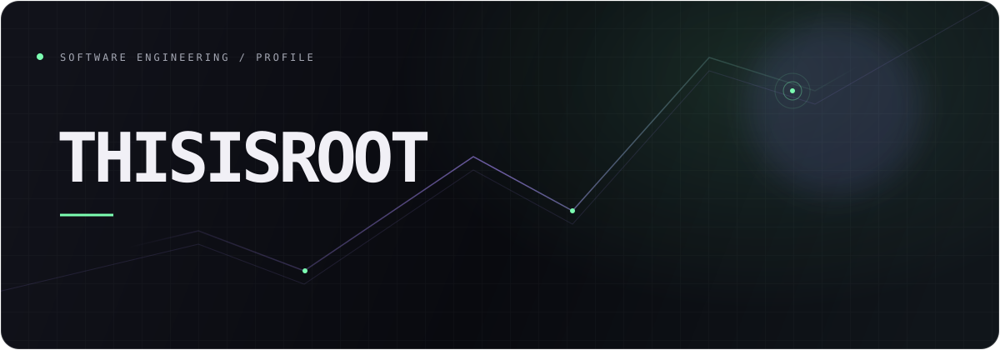
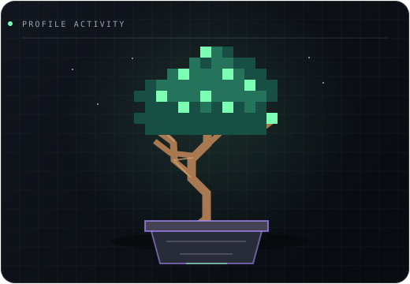

 

Software developer focused on systems engineering, cross-platform applications, and networked software.

  

<table>
  <tr>
    <td width="33%" valign="top">
      01 &nbsp; / &nbsp; SYSTEMS  
      <strong>Rust</strong> Backend engineering Cryptographic protocols
    </td>
    <td width="33%" valign="top">
      02 &nbsp; / &nbsp; APPLICATIONS  
      <strong>Flutter · Dart</strong> Cross-platform development Interface engineering
    </td>
    <td width="33%" valign="top">
      03 &nbsp; / &nbsp; PROTOCOLS  
      <strong>REST · WebSockets</strong> OpenAPI · JSON Schema Service integration
    </td>
  </tr>
</table>

 

CONTRIBUTION HISTORY

  

