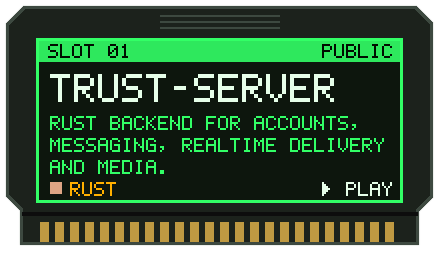
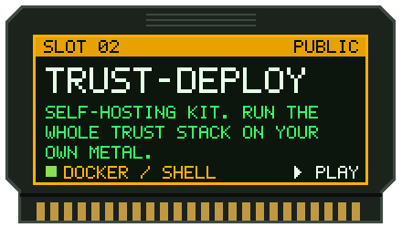
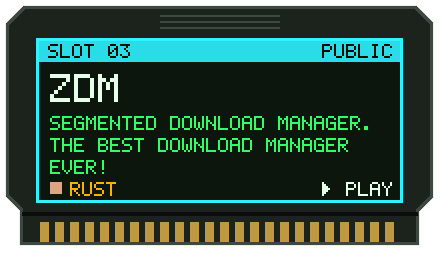
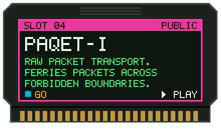
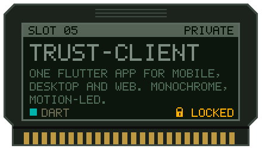
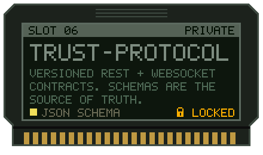

 

  

  
  
  
  
  
  

 

  

  

<picture>
  <source media="(prefers-color-scheme: dark)" srcset="https://raw.githubusercontent.com/thisisroot/thisisroot/output/snake-dark.svg" />
  <source media="(prefers-color-scheme: light)" srcset="https://raw.githubusercontent.com/thisisroot/thisisroot/output/snake-light.svg" />
  
</picture>

  

<!--
  Every graphic here is generated: edit the CONTENT section of scripts/arcade.py,
  then run `python scripts/arcade.py static`. The hi-score table and snake are
  rebuilt daily by .github/workflows/arcade.yml onto the `output` branch.
-->
