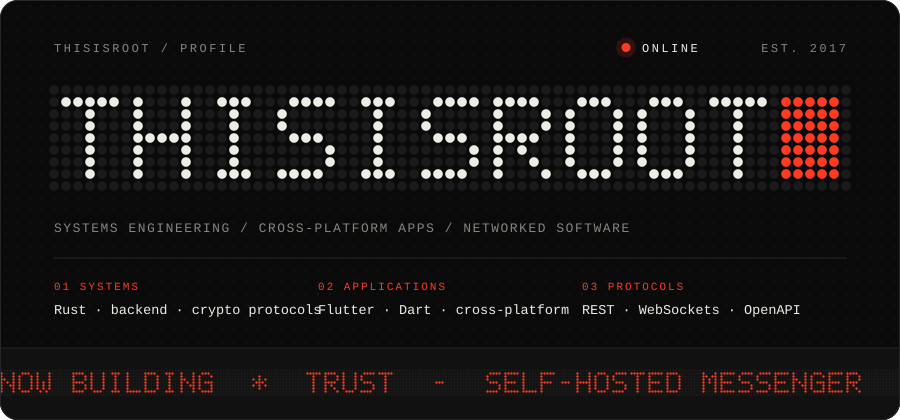
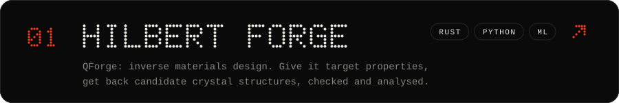
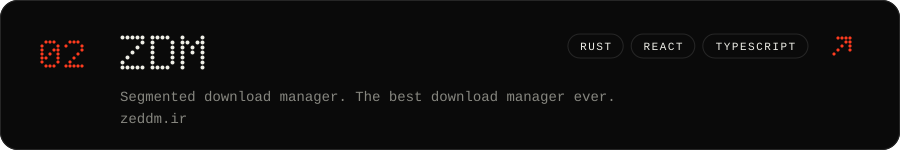
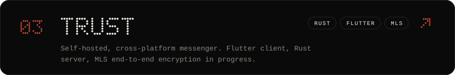
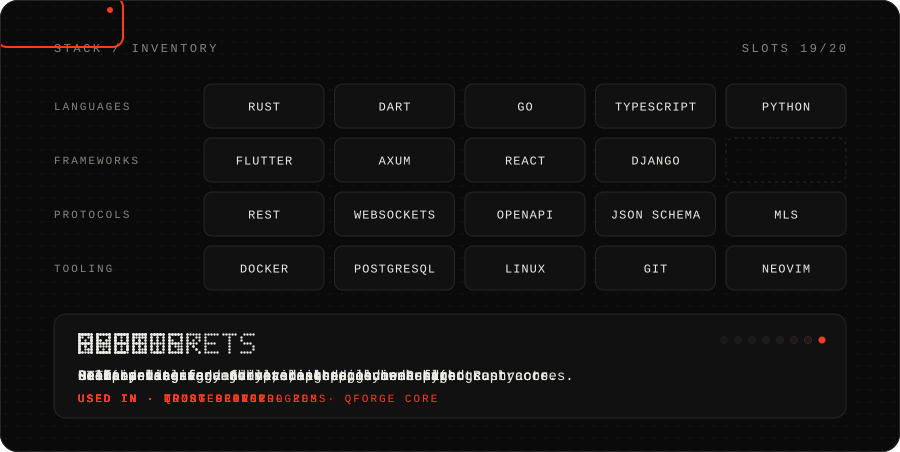

<picture>
  <source media="(prefers-color-scheme: dark)" srcset="./assets/hero-dark.svg" />
  <source media="(prefers-color-scheme: light)" srcset="./assets/hero-light.svg" />
  
</picture>

  

<a href="https://github.com/Hilbert-Forge">
<picture>
  <source media="(prefers-color-scheme: dark)" srcset="./assets/project-hilbertforge-dark.svg" />
  <source media="(prefers-color-scheme: light)" srcset="./assets/project-hilbertforge-light.svg" />
  
</picture>
</a>

<a href="https://github.com/thisisroot/zdm">
<picture>
  <source media="(prefers-color-scheme: dark)" srcset="./assets/project-zdm-dark.svg" />
  <source media="(prefers-color-scheme: light)" srcset="./assets/project-zdm-light.svg" />
  
</picture>
</a>

<a href="https://github.com/thisisroot/trust-server">
<picture>
  <source media="(prefers-color-scheme: dark)" srcset="./assets/project-trust-dark.svg" />
  <source media="(prefers-color-scheme: light)" srcset="./assets/project-trust-light.svg" />
  
</picture>
</a>

 

<picture>
  <source media="(prefers-color-scheme: dark)" srcset="./assets/stack-dark.svg" />
  <source media="(prefers-color-scheme: light)" srcset="./assets/stack-light.svg" />
  
</picture>

  

<picture>
  <source media="(prefers-color-scheme: dark)" srcset="https://raw.githubusercontent.com/thisisroot/thisisroot/output/telemetry-dark.svg" />
  <source media="(prefers-color-scheme: light)" srcset="https://raw.githubusercontent.com/thisisroot/thisisroot/output/telemetry-light.svg" />
  
</picture>

<!--
  All graphics are generated. Edit the CONTENT section of scripts/profile.py,
  then run: python scripts/profile.py static
  Telemetry is rebuilt daily by .github/workflows/telemetry.yml onto the `output` branch.
-->
